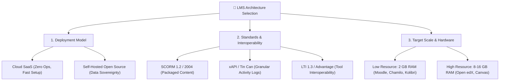
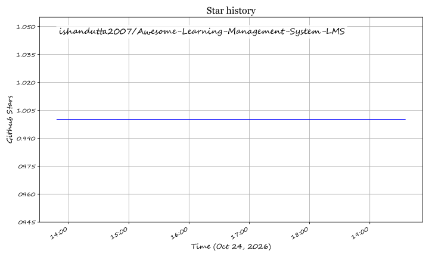

  

# 🎓 Awesome Learning Management Systems (LMS)

  
  
  
  
  
  

> 📚 **Curated Directory of Top SaaS Products & Open-Source GitHub Projects for Learning Management Systems (LMS), Online Course Delivery, SCORM/LTI Compliance, and Scalable Learner Analytics.**

A **Learning Management System (LMS)** is the software backbone used by educational institutions, universities, enterprise training departments, and independent creators to author, deliver, automate, and track instructional content. Whether deploying a massive open online course (MOOC), ensuring corporate compliance and safety certifications, or building an offline-first rural school portal, choosing the right LMS infrastructure dictates scalability, interoperability, and student learning outcomes.

---

## 📑 Table of Contents

- [🌐 Sector Overview & Market Dynamics](#-sector-overview--market-dynamics)
- [🏢 SaaS & Hosted LMS Platforms](#-saas--hosted-lms-platforms)
- [⚡ Open-Source LMS GitHub Projects](#-open-source-lms-github-projects)
- [🔍 Key Evaluation Criteria & Standards](#-key-evaluation-criteria--standards)
- [🤝 How to Contribute](#-how-to-contribute)
- [📈 Star History](#-star-history)
- [💖 Support & Community](#-support--community)
- [📄 Disclaimer](#-disclaimer)

---

## 🌐 Sector Overview & Market Dynamics

The global **Learning Management System (LMS)** market is estimated at **$24.1B to $30.4B in 2025** and projected to climb past **$30.5B to $36.9B in 2026**, progressing at a robust **CAGR of 13.5% to 19.3%** toward an anticipated **$60B+ footprint by 2030**. This expansion is fueled by widespread enterprise workforce upskilling, hybrid university models, and the integration of generative AI for personalized curriculum generation.

In terms of industry concentration, the LMS landscape is **moderately to highly fragmented across small-and-medium businesses (SMBs) and niche course creators**, where hundreds of cloud-native and regional vendors compete. However, **at the enterprise corporate and higher-education institutional tier, the market exhibits high concentration (oligopolistic tendencies)**: a small cohort of entrenched market leaders—including **Canvas (Instructure)**, **Anthology (Blackboard)**, **Cornerstone OnDemand**, and the global open-source footprint of **Moodle**—control a dominant share of institutional contracts and student user seats worldwide.

---

## 🏢 SaaS & Hosted LMS Platforms

The following enterprise cloud LMS solutions are sorted by **Company Scale / Valuation / Revenue (Descending)**.

| 🏢 Platform | 💰 Company Scale / Valuation / Revenue | 🏷️ Starting Tier Pricing | 🆓 Free Tier / Trial Limit | 🎯 Best For & Key Capabilities |
| :--- | :--- | :--- | :--- | :--- |
| **[Adobe Learning Manager](https://www.adobe.com/products/learning-manager.html)** | **~$220B+ Market Cap** *(Adobe Inc. NASDAQ: ADBE; ~$21.4B Annual Revenue)* | **$4.00 / learner / month** *(or ~$48/user/year; typical minimum contract starts at ~$4,000/year)* | **30-day free trial** *(Full-featured evaluation tenant with unlimited learner accounts and course authoring; no permanent free tier)* | **Global Enterprises & Adobe Ecosystems**: AI-recommended learning paths, headless LMS APIs, offline mobile learning, and native integration with Adobe Captivate authoring tools. |
| **[Cornerstone OnDemand](https://www.cornerstoneondemand.com/)** | **$5.2B Valuation** *(Acquired by Clearlake Capital; ~$900M+ Annual Revenue)* | **~$6.00 / user / month** *(Priced at ~$3.50–$8.00 PEPM based on volume; baseline entry modules start at ~$6,000/year)* | **14-day scoped sandbox POC** *(Guided enterprise sandbox environment provided upon sales demo consultation; no self-serve free-forever tier)* | **Regulated Enterprises & Talent Suites**: Unified talent management, automated compliance tracking, skills ontology, and deep HRIS integrations (Workday, SAP SuccessFactors). |
| **[Canvas LMS Cloud](https://www.instructure.com/canvas)** | **$4.8B Valuation** *(Acquired by KKR in 2024; ~$530M+ Annual Revenue)* | **~$3.00 – $15.00 / student / year** *(Priced per FTE; entry institutional contracts start at ~$3,500/year)* | **Free-Forever Plan ("Canvas Free for Teacher")** *(Permanent free plan capped at 500 MB course storage, 50 MB per student upload, SpeedGrader & quizzes; excludes SIS integration & DAP analytics)* | **Higher Education & K-12 Districts**: Dominant North American market share, SpeedGrader assessment workflows, rubrics, and modular LTI 1.3 learning app integrations. |
| **[360Learning](https://360learning.com/)** | **~$800M Valuation** *(Raised $243M Total Funding; ~$70M+ ARR)* | **$8.00 / user / month** *(Team plan up to 100 users with rolling monthly billing)* | **30-day free trial** *(Team plan trial supporting up to 100 users with full collaborative course creation and peer review features; no permanent free tier)* | **Collaborative Learning & Tech Scale-ups**: Peer-driven content creation, internal SME course authoring, feedback loops, and interactive employee upskilling. |
| **[Docebo](https://www.docebo.com/)** | **~$650M – $750M Market Cap** *(NASDAQ / TSX: DCBO; ~$200M+ Annual Revenue)* | **~$25,000 / year** *("Elevate" baseline plan, approx. ~$3.33/user/month for up to 500 Yearly Active Users)* | **14-day guided sandbox POC** *(Sales-assisted evaluation tenant configured for up to 30 test users with sample compliance modules; no self-serve free plan)* | **Multi-Audience & Extended Enterprise**: AI content tagging, social learning, white-labeled multi-tenant portals, and customer onboarding education. |
| **[Absorb LMS](https://www.absorblms.com/)** | **~$500M+ Valuation** *(Acquired by WCAS; ~$100M+ ARR)* | **~$14,500 / year** *(Base platform fee plus ~$3.00/user/month for lower learner tiers)* | **14-day evaluation demo tenant** *(Dedicated sandbox portal provisioned upon sales qualification with up to 10 sample learner seats; no perpetual free tier)* | **Corporate Training & eCommerce**: Turnkey eCommerce store for course sales, Absorb Intelligence AI tutoring, external partner education, and SCORM/xAPI compliance. |
| **[TalentLMS](https://www.talentlms.com/)** | **~$300M+ Valuation** *(Epignosis parent; ~$60M+ ARR)* | **$119 / month** *(Billed annually at $1,428/yr for Core tier, or $149/mo monthly billing for up to 40 active users)* | **Free-Forever Plan** *(Perpetual free plan for up to 5 active users, maximum 10 active courses, and 100 MB per-file upload cap; no credit card required)* | **SMBs & Agile Training Teams**: Rapid plug-and-play onboarding, built-in course builder, gamification badges, and TalentLibrary pre-built course catalog. |
| **[LearnUpon](https://www.learnupon.com/)** | **~$200M+ Valuation** *(Raised $107M Total Funding/Debt; ~$40M+ ARR)* | **~$599 / month** *(Essential tier billed annually at ~$7,188/year for up to 50 active learners)* | **14-day sales-assisted trial** *(Custom sandbox tenant loaded with up to 25 sample user logins upon demo consultation; no perpetual free tier)* | **Customer & Partner Training**: Multi-portal architecture allowing distinct branding and course catalogs for employees, customers, and resellers from a single dashboard. |

---

## ⚡ Open-Source LMS GitHub Projects

The following self-hosted and open-source LMS projects are sorted by **GitHub Stars_Count (Descending)**. Beside each project name is an official badge linking directly to the repository's stargazers.

| 🚀 Project & Repository | ⭐ Stargazers Badge | 🛠️ Tech Stack & License | 💡 Architecture & Key Highlights |
| :--- | :--- | :--- | :--- |
| **[Open edX Platform](https://github.com/openedx/openedx-platform)** |  | `Python` `Django` `React` `MySQL` `AGPL-3.0` | **The MOOC standard built by MIT & Harvard**: Powers edX.org at massive planetary scale. Features studio course authoring, auto-graded coding exercises, modular XBlocks, and deep analytics. Demands 8 GB+ RAM. |
| **[Moodle](https://github.com/moodle/moodle)** |  | `PHP` `MariaDB` `MySQL` `PostgreSQL` `GPL-3.0` | **The world's most deployed LMS**: Powers 300M+ learners across 240+ countries. 2,000+ community plugins, 40+ quiz question types, SCORM 1.2/2004, LTI 1.3 Advantage, and competency frameworks. Runs on 2 GB RAM. |
| **[Oppia](https://github.com/oppia/oppia)** |  | `Python` `Angular` `TypeScript` `Google Cloud` `Apache-2.0` | **Adaptive 1-on-1 personalized tutoring engine**: Simulates an interactive mentor rather than static lectures. Provides rich interactive explorations, automated mistake remediation, and open community lessons. |
| **[Canvas LMS](https://github.com/instructure/canvas-lms)** |  | `Ruby on Rails` `React` `PostgreSQL` `Redis` `AGPL-3.0` | **Instructure's open-source core**: Offers the identical core student UX as the commercial cloud version—SpeedGrader grading rubrics, assignment pipelines, discussion forums, and LTI 1.3 extensibility. |
| **[Frappe LMS](https://github.com/frappe/lms)** |  | `Python` `Frappe Framework` `Vue.js` `MariaDB` `GPL-3.0` | **Modern, lightweight full-featured LMS**: Built on Frappe and Vue. Features student cohorts, live video classrooms, assessments, discussion portals, certificates, and native ERPNext integration. |
| **[CourseLit](https://github.com/codelitdev/courselit)** |  | `Node.js` `Next.js` `MongoDB` `Stripe` `GPL-3.0` | **Open-source Teachable & Thinkific alternative**: Empowers creators and educators to sell video courses, digital products, and subscriptions on their own custom domain with built-in payments. |
| **[Sakai](https://github.com/sakaiproject/sakai)** |  | `Java` `Spring` `MySQL` `Oracle` `ECL-2.0` | **Collegiate academic learning suite**: Long-standing higher-education platform designed for university research collaboration, course syllabi, gradebooks, forums, and academic portfolios. |
| **[Kolibri](https://github.com/learningequality/kolibri)** |  | `Python` `Django` `Vue.js` `SQLite` `MIT` | **Offline-first LMS for zero-connectivity regions**: Engineered specifically for schools, refugee camps, and NGOs with unreliable internet. Runs seamlessly on low-cost Raspberry Pis with P2P sync. |
| **[Tutor](https://github.com/overhangio/tutor)** |  | `Python` `Docker` `Compose` `Caddy` `AGPL-3.0` | **The Docker-based Open edX distribution**: The official deployment engine for Open edX. Replaces complex manual setups with containerized single-command deployments (`tutor local launch`). |
| **[Chamilo LMS](https://github.com/chamilo/chamilo-lms)** |  | `PHP` `Symfony` `Vue 3` `MySQL` `GPL-3.0` | **Digital Public Good recognized LMS**: Highly accessible platform featuring 80+ language translations, Vue 3 interface (Chamilo 2.0), Open Badges, SCORM, and AI course generation. |
| **[Pupilfirst](https://github.com/pupilfirst/pupilfirst)** |  | `Ruby on Rails` `ReasonML` `React` `PostgreSQL` `MIT` | **Asynchronous school & mentorship platform**: Built around iterative task submissions, mentor review cycles, student progress dashboards, and structured feedback loops. |
| **[Sensei LMS](https://github.com/Automattic/sensei)** |  | `PHP` `WordPress` `WooCommerce` `GPL-2.0` | **Automattic's native WordPress LMS**: Integrates directly into existing WordPress sites, transforming pages into modular lessons, quizzes, and monetized courses via WooCommerce. |
| **[ILIAS](https://github.com/ILIAS-eLearning/ILIAS)** |  | `PHP` `MariaDB` `MySQL` `GPL-3.0` | **German-engineered compliance LMS**: Renowned across European government agencies and regulated institutions for rigorous test engines, competency matrix audits, and SCORM 2004 support. |

---

## 🔍 Key Evaluation Criteria & Standards

When selecting an LMS architecture, evaluate based on these three foundational dimensions:

### 1. Interoperability Protocols
- **SCORM (1.2 & 2004)**: The legacy package standard for packaging interactive modules created in Articulate 360, Adobe Captivate, or iSpring.
- **xAPI (Experience API / Tin Can)**: Emits rich statements (`actor - verb - object`) to a Learning Record Store (LRS), tracking activities beyond the LMS (mobile apps, VR simulations, webinars).
- **LTI (Learning Tools Interoperability 1.3 & Advantage)**: Secure OAuth2/OIDC integration allowing external third-party edtech tools (plagiarism checkers, code runners, virtual labs) to launch seamlessly within your LMS.

### 2. Infrastructure & Hosting Trade-offs
- **Modest Footprint (2 GB – 4 GB RAM)**: **Moodle** and **Chamilo** operate effectively on simple virtual private servers (one PHP-FPM container + MariaDB).
- **High Resource / MOOC Scale (8 GB – 16 GB+ RAM)**: **Canvas LMS** (Ruby on Rails stack + PostgreSQL + Redis + background workers) and **Open edX** (7+ microservices deployed via Tutor) require dedicated infrastructure and operational engineering.
- **Offline / Low-Bandwidth**: **Kolibri** is purpose-built to run on a $35 Raspberry Pi in remote areas without internet connectivity.

---

## 🤝 How to Contribute

Contributions are warmly welcomed! Help expand and maintain this directory:

1. 🍴 **Fork the repository** on GitHub.
2. 🌿 **Create a descriptive feature branch** (`git checkout -b add-new-lms-tool`).
3. 📝 **Add or update entries in `README.md`** following the existing table layout, including verified starting pricing, free limits, and links.
4. 🧪 **Ensure all links, markdown tables, and badges render cleanly**.
5. 🚀 **Submit a Pull Request** with a brief summary of the changes.

*Please review our curated collections on [Awesome-Awesome-Awesome](https://github.com/ishandutta2007/Awesome-Awesome-Awesome) for complementary developer resources.*

---

## 📈 Star History

---

## 💖 Support & Community

Thank you for visiting and using this curated guide to Learning Management Systems! If this repository has saved you research hours, helped you architect an educational portal, or guided your edtech stack decisions:

- ⭐ **Star this repository** to improve visibility for the global educator and open-source community.
- 🍴 **Fork and share** with colleagues, school administrators, and developers.
- 💬 **Join the conversation** on [Discord](tttps://discord.gg/jc4xtF58Ve) to discuss instructional design and LMS devops.
- ☕ **Sponsor the project**: Back ongoing research, benchmarking, and updates via the [GitHub Sponsor Dashboard](https://github.com/sponsors/ishandutta2007).

---

## 📄 Disclaimer

- This repository is a community-curated catalog for informational and educational purposes; listings do not imply commercial endorsement.
- All pricing, tier limits, and corporate valuations fluctuate over time and reflect publicly verifiable data and vendor disclosures as of 2026. Consult official vendor sites for contractual quotations.
- Trademarks, product logos, and brand names belong to their respective corporate and foundation entities.

## Star History

<a href="https://star-history.com/#ishandutta2007/Awesome-Learning-Management-System-LMS&Timeline" align="center">
  <picture>
    <source media="(prefers-color-scheme: dark)" srcset="assets/ishandutta2007_Awesome-Learning-Management-System-LMS_growth.svg">
    
  </picture>
</a>
